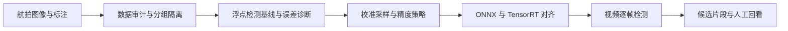

# DAMO-YOLO 航拍目标检测与推理优化

面向园区、道路航拍视频的地面离线分析，输出人员与车辆候选片段，供人工回看。本项目以 DAMO-YOLO-S 为浮点基线，围绕小目标与遮挡误差诊断、校准集选择、混合精度策略及部署一致性组织优化。工作时间：2026.08 至今。

已完成方案和四类辅助工具。本仓库现已上传[辅助工具源码](src/aerial_quant/)、[测试源码](tests/test_research_kit.py)、[打包配置](pyproject.toml)和[筛选配置](configs/acceptance_proposed.json)，具体安装、输入字段和调用方法见[实现说明](docs/IMPLEMENTATION.md)。检测器训练、ONNX/TensorRT 实机推理与视频效果评价仍在后续范围。

## 技术栈与职责

| 技术 | 具体作用 |
|---|---|
| Python、PyTorch、DAMO-YOLO-S（L25_S） | 数据处理、浮点模型与训练基线 |
| ONNX | 模型导出和跨运行时输出对齐 |
| TensorRT | 目标部署后端，比较 FP32、FP16 与部分 INT8 |
| 数据审计与策略工具 | 检查标注、隔离数据分组、选择校准图、筛选满足约束的精度策略 |

## 从数据到候选片段



**类别保持一致。** 采用 VisDrone 的十类：pedestrian、people、bicycle、car、van、truck、tricycle、awning-tricycle、bus、motor。忽略区 0 和 others 11 按任务规则处理。界面可把类别汇总为人员或车辆，但模型训练与计分保留原类别。

**先定位浮点误差。** 将失败样本按尺度、遮挡和密度分组，区分领域差异、目标过小、漏标与预处理问题，再判断量化引入的额外损失。训练、校准、开发与最终测试分开；自采视频按航次或采集批次隔离。

**在相同预算下选择校准集。** 方案预算为 512 张图像，使用覆盖采样与随机采样作对照，固定随机种子与分组上限。`calibration.py` 已提供固定预算的贪心覆盖与分组限制。512 是设计预算，未作为已完成训练规模。

**精度策略需要落到真实后端。** `policy.py` 记录显式模块名、策略与清单哈希；它不自动建立 PyTorch 模块到 TensorRT 层的对应关系。最终需检查实际层精度及回退情况，再比较精度与时延。

## 已有工具与效果口径

| 工具 | 已有能力 |
|---|---|
| [data_audit.py](src/aerial_quant/data_audit.py) | 标注字段、ID、图像哈希及分组划分检查；现有接口仍需与正式数据划分对应 |
| [calibration.py](src/aerial_quant/calibration.py) | 固定数量采样、覆盖选择及分组上限 |
| [policy.py](src/aerial_quant/policy.py) | 按模块名校验部分量化策略及模块清单哈希 |
| [selection.py](src/aerial_quant/selection.py) | 根据输入的 AP、分组召回和 P95 筛选候选；本工具不负责测量这些指标 |

[原包历史记录](reports/historical-20261017/README.md)保存了 36 项构造 CPU 回归，用时 1.68 秒，当时 CUDA 不可用；本次源码补传没有重跑。当前没有个人模型 AP、TensorRT 时延或显存收益可报告。

检测效果使用 VisDrone AP 系列，并单列缩放后短边小于 16 像素的 `R_tiny`。`R_tiny` 与标准 `AP_small` 使用不同定义。部署效果分开记录模型 P95 时延、视频端到端实时因子、显存和关键场景召回，策略只有同时满足质量与资源约束才可采用。

## 使用方法与输出格式

先按[实现说明](docs/IMPLEMENTATION.md)安装 Python 包。现有 CLI 支持分区审计和实测候选筛选，覆盖采样与模块策略使用 Python 接口。

```powershell
py -3 -m venv .venv
& .\.venv\Scripts\python.exe -m pip install -e .
New-Item -ItemType Directory -Force reports | Out-Null
& .\.venv\Scripts\python.exe -m aerial_quant.cli audit-splits --input partitions.json --output reports/split-audit.json
& .\.venv\Scripts\python.exe -m aerial_quant.cli select --input measurements.json --output reports/selection.json --baseline fp16 --constraints configs/acceptance_proposed.json
```

在仓库根目录执行上述命令，提前准备实际的 `partitions.json` 和 `measurements.json`；字段要求见实现说明。完整检测系统采用以下方案流程，训练和推理主程序尚未发布。

1. 输入航拍视频或逐帧图像，保留原始视频时间戳、分辨率与批次 ID。
2. 完成数据审计，以浮点模型建立相同输入上的误差基线。
3. 固定校准预算，比较覆盖采样与随机采样，再选择部分 INT8 策略。
4. 逐后端核对缩放、归一化、NMS 和坐标还原；在相同硬件与批量条件下计时。
5. 输出候选记录：视频 ID、帧 ID、原始 PTS、原图坐标框、原类别、置信度、模型版本、候选片段和复核状态。

候选片段合并用于减少人工查找。跨帧身份跟踪和唯一人数统计需要独立能力，未纳入现有交付。

## 参考

[DAMO-YOLO](https://github.com/tinyvision/DAMO-YOLO/tree/319572eef367340267ab6ab8ae253527a71d7c3a)、[VisDrone DET toolkit](https://github.com/VisDrone/VisDrone2018-DET-toolkit/tree/005445782213e20cb91bc50a597db3dd949e749a)、[VisDrone](https://github.com/VisDrone/VisDrone-Dataset/tree/4364e8265275dfa44fd8f767b5180af58580194d)。版本与许可见[简要来源](docs/SOURCES.md)及 [data/sources.json](data/sources.json)，原样实现的文件哈希见 [code-files.json](data/code-files.json)。
